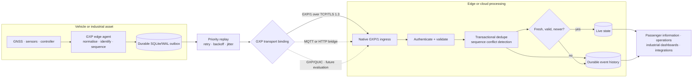
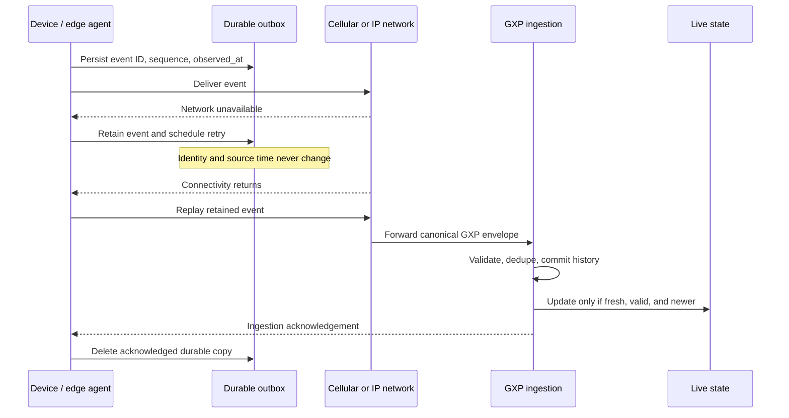

# GXP — Geo eXchange Protocol

**A freshness-aware, offline-resilient application protocol for industrial events, mobile telemetry, and safe device operations.**

GXP gives devices, gateways, services, and applications one consistent contract
for answering the operational questions that transports alone cannot answer:

> Is this data still useful? Was it already processed? Can it safely be replayed?
> Which position is truly current? May this command still execute?

GXP is an experimental application-layer protocol and reference implementation.
Its future canonical wire is **GXP/1**: a native framed session protocol with
its own handshake, capability negotiation, acknowledgements, resume, flow
control, and command lifecycle. It still reuses established TCP/TLS and later
QUIC rather than reinventing IP, cryptography, or congestion control. MQTT,
HTTP, Sparkplug, and OPC UA are compatibility/integration paths—not the
definition of GXP. Its first profile, BusRoot, addresses real-time bus location
while preserving truth during cellular outages.

## Why GXP exists

An industrial asset can create data when the network is unavailable, change
networks while moving, retry after an acknowledgement is lost, or send a valid
GPS position that is already too old for a live dashboard. A conventional
“send JSON to a server” path leaves those decisions to every application.

GXP makes them explicit:

| Operational problem | GXP contract |
| --- | --- |
| A bus reappears after a dead zone | Events retain their original ID, sequence, and observation time through durable replay. |
| Delayed GPS reaches the cloud | History can retain it, but the freshness gate prevents it from moving the live marker backward. |
| A retry arrives after a server commit | Transactional event-ID deduplication returns a successful duplicate acknowledgement. |
| Connectivity is intermittent | SQLite/WAL edge persistence, priority ordering, retry backoff, and jitter preserve eligible events. |
| A remote command arrives late | Command IDs, expiry, operation policy, and lifecycle state make “arrived” different from “safe to execute.” |
| Deployments use different transports | One canonical envelope maps to HTTP/TLS today and MQTT 5/TLS as an optional adapter. |

## Architecture at a glance



### What happens during a network outage



## What makes GXP different

GXP's value is not that it claims existing protocols are broken. MQTT 5 already
provides useful QoS choices; Sparkplug adds industrial MQTT conventions; QUIC
supports secure multiplexing and client path migration; OPC UA provides an
established information-model ecosystem. GXP/1 combines a native **application
wire protocol** with portable event semantics, session resume, explicit ACK
ranges, priority/credit flow control, freshness, and command safety across
those integrations.

| Technology | Excellent at | Where GXP fits |
| --- | --- | --- |
| MQTT 5 | Lightweight publish/subscribe delivery with QoS, sessions, and message-expiry features | Use a bridge during migration or integration; GXP/1 is the future canonical session and frame protocol. |
| Sparkplug | MQTT topic namespace, payload conventions, and industrial device/session state | Integrate or bridge when a customer already uses Sparkplug; do not replace its ecosystem by default. |
| HTTP/HTTPS | Ubiquitous request/response transport and operational simplicity | Use a compatibility/ingestion bridge where gateways need a firewall-friendly route. |
| QUIC | Secure streams, multiplexing, and optional client network-path migration | GXP/QUIC is a future native binding when real carrier and middlebox tests support it; application-level replay remains necessary. |
| OPC UA | Industrial information models and PubSub interoperability | Preserve existing models and add a mapping only where industrial users need it. |

The standards review and decisions behind this position are documented in the
[architecture review](docs/research/phase-0-architecture-review.md). References:
[MQTT 5](https://docs.oasis-open.org/mqtt/mqtt/v5.0/mqtt-v5.0.html),
[Sparkplug](https://sparkplug.eclipse.org/specification/),
[QUIC](https://www.rfc-editor.org/rfc/rfc9000.html), and
[OPC UA PubSub](https://reference.opcfoundation.org/specs/OPC-10000-14/full).

## Where to use GXP

GXP is a strong fit when source time, offline behavior, and safe replay matter
as much as successful network delivery:

- **Public transport and fleet tracking:** keep passenger-facing live positions
  honest while retaining delayed route history after coverage loss.
- **Mobile and remote industrial assets:** monitor pumps, generators, utility
  equipment, construction assets, and logistics fleets over variable networks.
- **Industrial edge gateways:** normalise multiple sensors and submit a
  consistent event stream without locking every downstream system to one
  transport.
- **Environmental and agricultural monitoring:** preserve critical observations
  across long connectivity gaps while identifying their true observation age.
- **Operations and maintenance:** deliver durable faults, health reports, and
  controlled diagnostics with idempotent processing and command expiry.
- **Connected equipment and dispensers:** report stock, motor, sensor, and
  dispense outcomes reliably while preventing a replayed command from producing
  a second physical action. See the [smart-feeder MQTT profile](docs/profiles/smart-feeder-mqtt.md).

GXP is not the right choice for every problem. Use a native OPC UA deployment
when its existing model and communication profiles meet the requirement; use
plain MQTT or HTTP when simple telemetry does not need GXP’s semantics; do not
use this reference implementation for safety-critical control or public
production traffic.

## What is implemented today

| Capability | Reference status |
| --- | --- |
| Versioned JSON envelope and language-neutral schema | Implemented |
| Event IDs, boot IDs, per-boot sequence validation, source/server time separation | Implemented |
| Delivery classes: live, durable, command, bulk, heartbeat | Specified; live/durable/command paths validated in the reference |
| Durable edge queue, priority replay, backoff, jitter, quota policy | Implemented with SQLite/WAL |
| Idempotent ingestion and sequence-conflict detection | Implemented with SQLite transactions |
| Freshness-aware BusRoot live state | Implemented and tested |
| HTTP/JSON ingestion | Implemented; TLS-capable local development server |
| GXP/1 native binary session | Architecture drafted; implementation, frame registry, and independent tests required |
| MQTT 5 | Compatibility bridge/publish adapter; broker and ingestion-ack integration are not yet tested |
| QUIC, Sparkplug, OPC UA bridges | Deferred pending a specific profile and field evidence |
| Production mTLS, PKI lifecycle, horizontal scale, real hardware validation | Required before a production pilot |

## Quick start

### Prerequisites

- Python 3.11 or newer
- No required third-party Python dependency for the local HTTP/reference path

```powershell
git clone https://github.com/geo-cherian-mathew-2k28/GXP-Protocol.git
Set-Location GXP-Protocol
py -3 -m unittest discover -s tests -v
```

The local test suite currently verifies envelope validation, durable replay
mechanics, acknowledgement handling, deduplication, sequence conflicts, stale
position protection, expired commands, and authenticated HTTP ingestion.

The current runnable server uses the HTTP compatibility bridge. The native GXP/1
frame codec is tested in the reference package, while the native GXP/TCP/TLS
session listener and embedded GXP-M/1 client are the next implementation
milestone.

### Watch the BusRoot outage/recovery flow

```powershell
py -3 examples/simulate_busroot.py
```

Representative output (event IDs vary):

```json
{
  "outage_flush": { "acknowledged": 0, "retried": 2, "rejected": 0 },
  "queued_during_outage": 2,
  "recovery_flush": { "acknowledged": 2, "retried": 0, "rejected": 0 },
  "delayed_flush": { "acknowledged": 1, "retried": 0, "rejected": 0 },
  "history_events": 3,
  "stale_event_rejected_from_live": true
}
```

That final `true` is the critical outcome: an old coordinate may remain useful
for history, but it is not allowed to become the current bus position.

### Run a local ingestion endpoint

Create a development-only device credential. The raw token is shown once; keep
it out of source control and use a real secret manager outside local work.

```powershell
py -3 -m gxp.cli bootstrap-device --db .\server.db --tenant busroot-kerala --device bus-104-gps
py -3 -m gxp.cli server --db .\server.db --host 127.0.0.1 --port 8080
```

The server binds to loopback by default. It must not be exposed publicly as-is.
See the [installation guide](docs/installation.md) for a TLS-enabled local run.

### Use GXP from a Python edge agent

```python
from gxp.edge import EdgeAgent, SQLiteEdgeSpool
from gxp.transports.http import HttpTransport

agent = EdgeAgent(
    tenant="busroot-kerala",
    device_id="bus-104-gps",
    spool=SQLiteEdgeSpool("edge.db"),
    clock_quality="gnss",
)

agent.create_event(
    kind="telemetry",
    event_type="vehicle.position",
    schema="gxp.busroot.position",
    payload={
        "latitude": 9.5661,
        "longitude": 76.7874,
        "speed_kmh": 32.4,
        "heading_deg": 87.0,
        "gps_fix": True,
    },
    delivery_class="LIVE_EPHEMERAL",
    priority=3,
    max_age_ms=15_000,
    quality={"status": "valid", "position_accuracy_m": 5.0},
)

result = agent.flush(
    HttpTransport("http://127.0.0.1:8080/v1/events", token="<development-token>")
)
print(result)
# {'acknowledged': 1, 'retried': 0, 'rejected': 0}
```

The agent persists the event before attempting delivery. A retryable failure
keeps it in the outbox; a new or duplicate ingestion acknowledgement permits its
removal.

### Run the narrow local benchmark harness

```powershell
py -3 benchmarks/ingest_benchmark.py --events 1000
```

It measures only local Python/SQLite ingestion calls and labels that scope in
its JSON output. It is not an MQTT, HTTPS, cellular, hardware, or comparative
performance result.

## Protocol model

Every event carries a version, tenant/device identity, immutable event ID,
sequence, event type/schema, source time, delivery intent, quality, and payload.

```json
{
  "gxp": "0.1",
  "kind": "telemetry",
  "tenant": "busroot-kerala",
  "device": {
    "id": "bus-104-gps",
    "boot_id": "b7a9c0e1-5a3f-4d2b-a2a8-5a3f0c8a1111",
    "sequence": 18293
  },
  "event": {
    "id": "0192f3a0-7e4a-4c2b-9c0e-6f7a1c2d3e4f",
    "type": "vehicle.position",
    "schema": "gxp.busroot.position",
    "schema_version": 1,
    "content_type": "application/json"
  },
  "time": {
    "observed_at": "2026-11-10T12:30:05.250Z",
    "sent_at": "2026-11-10T12:30:05.400Z",
    "clock_quality": "gnss"
  },
  "delivery": {
    "class": "LIVE_EPHEMERAL",
    "max_age_ms": 15000,
    "priority": 3
  },
  "quality": { "status": "valid", "position_accuracy_m": 5.0 },
  "payload": { "latitude": 9.5661, "longitude": 76.7874, "gps_fix": true }
}
```

The server adds `received_at` itself. It never treats device arrival claims as
authoritative server time.

## Documentation and project map

| Start here | What it answers |
| --- | --- |
| [GXP specification](GXP_SPECIFICATION.md) | Wire model, message format, delivery semantics, transports, errors, and versions |
| [Architecture](GXP_ARCHITECTURE.md) | Components, boundaries, and design trade-offs |
| [Developer guide](GXP_DEVELOPER_GUIDE.md) | Run, integrate, and implement another binding |
| [Security](GXP_SECURITY.md) | Threat model, current controls, and production gates |
| [Conformance](GXP_CONFORMANCE.md) | What a compatible implementation must prove |
| [Interoperability](GXP_INTEROPERABILITY.md) | Current HTTP/MQTT status and deferred integrations |
| [Benchmarks](GXP_BENCHMARKS.md) | Executed local measurement and fair comparison methodology |
| [Release readiness](RELEASE_READINESS.md) | Honest evidence, blockers, and next gates |
| [Human action required](HUMAN_ACTION_REQUIRED.md) | Legal, registration, pilot, and ownership tasks |
| [Smart-feeder native GXP profile](docs/profiles/smart-feeder-mqtt.md) | A practical Arduino Uno R4 WiFi path from MQTT compatibility to GXP/1 native sessions |
| [Repository metadata](REPOSITORY_METADATA.md) | Copy-ready GitHub description, topics, and discoverability checklist |

Repository directories:

- `gxp/` — reference implementation
- `specification/` — protocol drafts and transport mappings
- `schemas/` — language-neutral JSON Schema
- `tests/` — unit, integration, conformance, and fault-oriented tests
- `examples/` — executable BusRoot demonstrations
- `benchmarks/` — reproducible measurement harnesses
- `deployment/` — local Docker development material

## Engineering principles

1. **Truth over arrival time.** A server receiving an event now does not mean
   the device observed it now.
2. **Durability before convenience.** Important events are persisted before
   delivery and remain until the required acknowledgement arrives.
3. **At-least-once transfer, explicit idempotency.** Networks retry; applications
   need stable event IDs and durable deduplication rather than vague exactly-once
   claims.
4. **Transport-neutral semantics.** Adapters preserve GXP meaning or declare
   their limitation.
5. **Safe commands by design.** Device-side policy, authorization, expiry,
   allowlists, and auditability are mandatory; safety-critical control is out of
   scope.
6. **Measured claims only.** Benchmarks, hardware tests, and field validation
   must be reproducible before they become marketing claims.

## Current maturity and contribution

GXP is ready for isolated technical evaluation, experimentation, and feedback.
It is not ready for public production deployment, a safety system, a standards
submission, or an unreviewed Internet-facing service.

Before a real pilot, complete production device identity and credential
lifecycle, authorization, audit/rate-limit/monitoring, production persistence
and recovery, hardware/cellular testing, privacy/safety approvals, and fair
benchmarking. See [release readiness](RELEASE_READINESS.md) and
[known limitations](KNOWN_LIMITATIONS.md).

Contributions should improve the specification, conformance evidence, transport
interoperability, or measured reliability—not merely add code volume. Read
[CONTRIBUTING.md](CONTRIBUTING.md) and [SECURITY.md](SECURITY.md) first.

## Licence and naming

The project owner has not selected a public software licence. The repository
currently grants no reuse licence. `GXP` and `gxp://` are provisional names and
are not claimed as trademarks or registered URI schemes. See
[HUMAN_ACTION_REQUIRED.md](HUMAN_ACTION_REQUIRED.md) before any public-release
or registration action.

